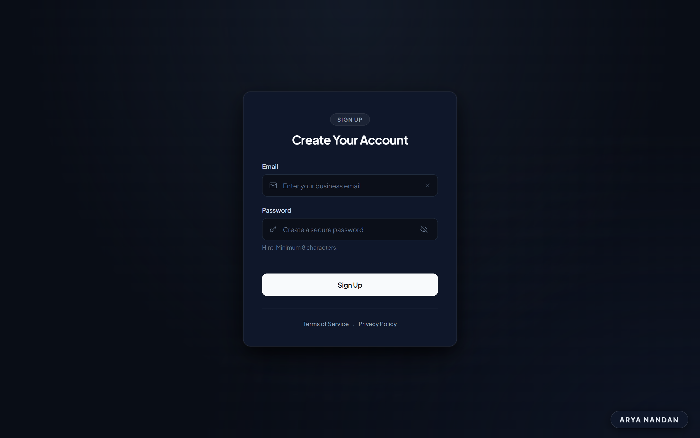
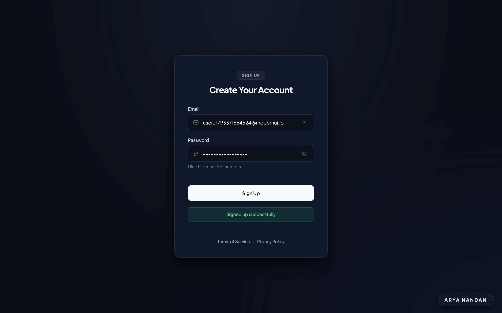
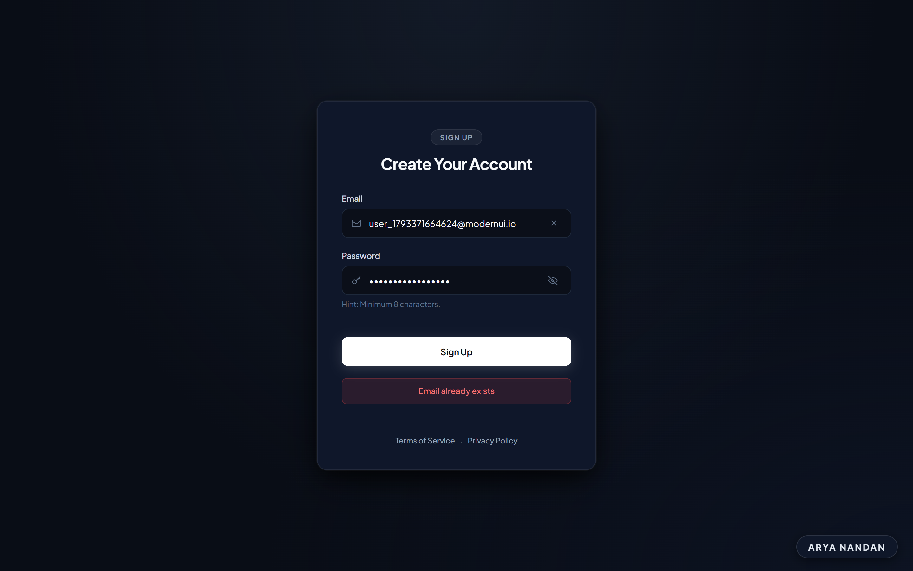
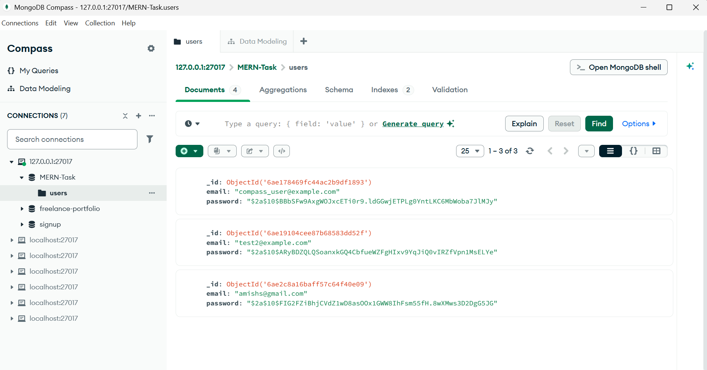

# Modern Sign-Up Application

A full-stack authentication sign-up application built with React, Vite, Express.js, and MongoDB. The user interface features a contemporary, dark-themed design crafted with typography, refined visual hierarchy, and feedback states.

## Overview & UI Redesign

The frontend has been redesigned to deliver a human-designed authentication experience:
- **Dark Theme Palette**: Deep obsidian background (`#090d16`) with ambient radial illumination and dark slate card surfaces (`#0f172a`).
- **Typography & Hierarchy**: Powered by the **Plus Jakarta Sans** font family, utilizing structured pill badges and hero headings for clear visual flow.
- **Form Component Polish**: Refined inputs with inset styling, sky-blue (`#38bdf8`) active focus rings, instant credential clearing, and password visibility toggling.
- **Visual Feedback**: Alert indicators for both successful registration (emerald green) and duplicate account prevention (crimson red).
- **Responsive Layout**: Designed for seamless presentation across desktop, tablet, and mobile displays.
- **Designer Watermark**: Subtle **`ARYA NANDAN`** watermark fixed at the bottom-right corner.

## Tech Stack

- **Frontend**:
  - React 18
  - Vite 5
  - Modern CSS (Custom Design System, Flexbox, CSS Grid)
  - Plus Jakarta Sans Typeface
- **Backend**:
  - Node.js
  - Express.js
  - RESTful API Architecture
- **Database & Security**:
  - MongoDB & Mongoose
  - bcryptjs (salted password hashing)

## Project Structure

```
task2/
├── .gitignore
├── README.md
├── client/
│   ├── index.html
│   ├── package.json
│   ├── package-lock.json
│   ├── vite.config.js
│   └── src/
│       ├── App.jsx
│       ├── main.jsx
│       └── style.css
├── screenshots/
│   ├── mongodb-compass-records.png
│   ├── sign-up-default.png
│   ├── sign-up-error.png
│   └── sign-up-success.png
└── server/
    ├── package.json
    ├── package-lock.json
    └── server.js
```

## Getting Started

### Prerequisites

- [Node.js](https://nodejs.org/) (v18+ recommended)
- [MongoDB](https://www.mongodb.com/) installed and running locally on `mongodb://127.0.0.1:27017`

### 1. Database Setup

Ensure your local MongoDB daemon is running. The application automatically connects to database `MERN-Task` and manages the `users` collection.

```bash
# Verify MongoDB service status (Windows)
Get-Service -Name MongoDB
```

### 2. Backend Server

```bash
cd server
npm install
npm start
```

The Express API server will listen on `http://localhost:3000`.

### 3. Frontend Client

Open a new terminal window:

```bash
cd client
npm install
npm start
```

The Vite development server will launch at `http://localhost:5173` with proxy routing to the backend.

## API Specification

| Endpoint | Method | Payload | Description |
|---|---|---|---|
| `/signup` | `POST` | `{ "email": "user@example.com", "password": "..." }` | Validates input, hashes password with bcrypt (cost factor 10), and stores user in MongoDB. |

## Screenshots

### 1. Redesigned Sign-Up Interface (Default State)

*Clean, dark-themed sign-up interface showing typography, input fields, password toggle, and the ARYA NANDAN watermark.*

### 2. Registration Success State

*Real-time submission confirmation displaying the emerald green "Signed up successfully" feedback banner.*

### 3. Validation & Duplicate Account Error State

*Error handling preventing duplicate email registration with the crimson "Email already exists" alert.*

### 4. Database Records Verification (MongoDB Compass)

*MongoDB Compass view of the `users` collection within database `MERN-Task`, confirming secure bcrypt password hashing.*
